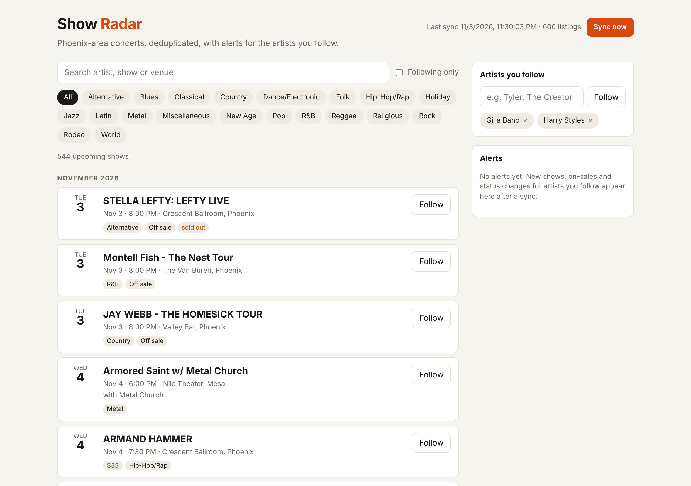

<h1 align="center">Show Radar</h1>

<p align="center">
  <strong>Follow artists. Get alerted when they announce a Phoenix show, when tickets go on sale, and when a show is rescheduled or cancelled.</strong>
</p>

<p align="center">
  <a href="https://github.com/bezalelchris/Show-Radar/actions/workflows/ci.yml"></a>
  
  
  
  
  
</p>

<picture>
  <source media="(prefers-color-scheme: dark)" srcset="docs/screenshot-dark.png">
  
</picture>

Concert discovery is noisy. One night at one venue can appear in Ticketmaster's feed three times, as a ticket-only listing, a "ticket + hotel package", and a separate 21+ listing from another ticketing system. Names are cluttered with `*SOLD OUT*`, `- Ages 16+`, and `| Official Ticket + Hotel Packages`. Show Radar syncs the feed, cleans every listing, merges duplicates into one show, and tracks what changes between syncs.

## Features

- **Duplicate detection:** 600 real listings collapse into 544 shows. A ticket, its hotel package, and its 21+ twin become one card, while early and late sets by the same artist stay separate.
- **Listing cleanup:** extracts headliner, age limit, package/add-on type, and status flags (`sold out`, `postponed to …`) from messy names.
- **Change detection:** every sync is snapshotted, so new shows, status changes (rescheduled, cancelled), on-sale date changes, date/time moves, and price changes are diffed against the previous sync.
- **Follow alerts:** follow artists, including supporting acts. Matching ignores case and accents (`Vale` follows `VALÉ`) but is exact, so following "WAR" won't alert you about "The War on Drugs". You also get an alert 72 hours before tickets go on sale.
- **Web UI and CLI:** search, genre filters, a "following only" view, and expandable merged listings. Responsive, dark-mode aware, keyboard accessible.

## How well does deduplication work?

Every pair of listings at the same venue on the same day from a real 600-listing Phoenix sync was hand-labeled "same performance" or "different performance" ([`eval/listing_pairs.jsonl`](eval/listing_pairs.jsonl), 78 pairs, 1 ambiguous slot excluded).

```
$ python -m showradar.evaluate
matcher                precision  recall     F1  accuracy
exact-name baseline        60.0%   21.8%   0.32     34.6%
show radar                100.0%  100.0%   1.00    100.0%
```

> **Caveat:** the matching rules were written while studying this same data, so treat 100% as a development-set score, not a guarantee. The real test is a held-out set from a future sync (see roadmap). The eval runs in CI as a regression gate (≥95% precision and recall).

## Engineering notes

| Finding | Decision |
|---|---|
| Only **15% of events have real prices** (89 of 600; another 22 are `$0` placeholders), and they're static face-value ranges. Measured with [`scripts/probe_prices.py`](scripts/probe_prices.py) before building. | Built the product around announcements, on-sales, and status changes, which the API covers well. Prices are shown and tracked when present, and `$0` placeholders are treated as missing. |
| **The same venue has different IDs** in Ticketmaster, TicketWeb, and Eventim. Matching on venue ID found under half the duplicates. | Venues are keyed by normalized name. Found by reading the matcher's misses in the eval output. |
| Duplicate listings can start minutes apart (doors vs. show), while real early/late sets are 1.5 to 2+ hours apart. | Same show = same venue + same day + start within 60 minutes + shared artist ID or near-identical folded headliner. Matches are merged with union-find, comparing only within venue-day buckets. |
| A fresh install would see every event as "new". | The first sync records a baseline silently. Alerts start from the second sync. |
| Raw API payloads are stored, not just parsed fields. | Cleanup and matching can improve without re-fetching history. |
| Arizona doesn't observe DST. | "Today" uses a fixed UTC-7 offset, which is exact and avoids a `tzdata` dependency on Windows. |
| 5,000 calls/day, 5 req/s quota. | One sync costs at most 5 calls, throttled to 4 req/s, with clear errors for 401 and 429. |

## Architecture

```
Ticketmaster Discovery API
        │  ticketmaster.py   paginated fetch, throttled, injectable for tests
        ▼
store.apply_sync()           SQLite: listings (raw JSON) · snapshots per sync · changes · follows
        │
listing.py                   raw event → Listing + CleanName (headliner, age, package, flags)
matching.py                  same_show() rules + union-find → shows
service.py                   shows / follows / alerts, shared by:
        ├── cli.py           showradar sync | shows | follow | alerts | serve
        └── api.py           FastAPI JSON API + static single-page UI (static/index.html)
```

**Stack:** Python 3.10+, FastAPI, SQLite, vanilla JS. The Ticketmaster client uses only the standard library. SQLite needs zero setup and handles thousands of listings per sync easily, and the schema ports directly to Postgres for a hosted version.

## Getting started

```bash
git clone https://github.com/bezalelchris/show-radar && cd show-radar
python -m venv .venv
.venv\Scripts\activate          # macOS/Linux: source .venv/bin/activate
pip install -e ".[dev]"

copy .env.example .env          # macOS/Linux: cp .env.example .env
# put your free Ticketmaster Consumer Key in .env (developer.ticketmaster.com)

showradar sync                  # first sync records a baseline
showradar follow "Gilla Band"
showradar shows --followed
showradar serve                 # http://127.0.0.1:8000
```

Run `showradar sync` again later (or click **Sync now**) and changes for artists you follow appear under `showradar alerts` and in the UI.

### Environment variables

| Variable | Default | Purpose |
|---|---|---|
| `TICKETMASTER_API_KEY` | *(required)* | Discovery API consumer key |
| `SHOWRADAR_LAT` / `SHOWRADAR_LON` | Phoenix | Search center |
| `SHOWRADAR_RADIUS_MILES` | `40` | Covers Tempe, Mesa, Scottsdale, Glendale |
| `SHOWRADAR_MAX_PAGES` | `5` | 200 events per page |
| `SHOWRADAR_DB` | `data/showradar.db` | SQLite file |

## API

| Endpoint | Description |
|---|---|
| `GET /api/shows?q=&genre=&followed=` | Upcoming shows, duplicates merged |
| `GET /api/alerts` | Changes for followed artists, newest first |
| `GET/POST /api/follows`, `DELETE /api/follows/{key}` | Manage follows |
| `POST /api/sync` | Pull the latest events |
| `GET /api/status` | Last sync time and counts |

Interactive docs: `http://127.0.0.1:8000/docs`.

## Testing

```bash
pytest -q                       # 40 tests
python -m showradar.evaluate    # dedup precision/recall on the labeled pairs
```

Tests cover name cleanup on real messy listings, matching rules (packages, age variants, early/late sets), every change type including removal and reappearance, follow matching edge cases, on-sale-soon alerts, API pagination and errors (with a fake HTTP client), and the web API. CI runs lint, tests, and the eval on Ubuntu and Windows.

## Roadmap

- [ ] Held-out eval: label pairs from a sync one week later and report that score
- [ ] Scheduled syncs (cron / GitHub Actions) and email or push alerts
- [ ] Hosted deployment with per-user follows (Postgres)
- [ ] LLM fallback for ambiguous pairs, measured against the rule-based matcher on the same eval
- [ ] Import followed artists from Spotify

## Data

Event data comes from the [Ticketmaster Discovery API](https://developer.ticketmaster.com) and is subject to its terms. The synced database stays local (`data/` is git-ignored). The eval file contains a small set of listing records used only to measure matching quality.

## License

MIT
